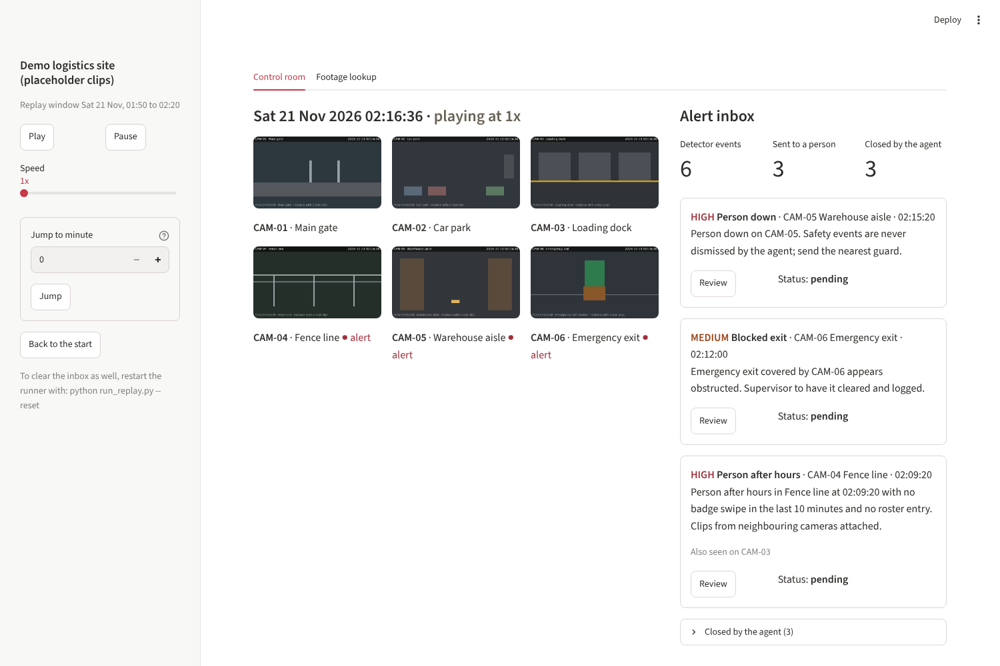

# CCTV Playground: kit reference

Written on 20 Nov 2026, before the agent was built, and moved here from the README on 22 Nov. Results and the current setup are in the [README](../README.md).

This kit stands in for a site's cameras and recorder during the proof of concept. Recorded clips are placed on one site timeline, a replay clock decides what time it is "now", and agents get footage only through tools that refuse anything after "now". A Streamlit screen shows the camera wall, the alert inbox and the agent's steps.



It runs today on generated placeholder clips, with a stand-in detector and a stand-in triage. You replace those three pieces with real clips, the real detector and the real agent.

## Run the placeholder site

You need Python 3.10 or newer and ffmpeg on the system (`brew install ffmpeg`, `apt install ffmpeg` or `winget install ffmpeg`).

```
pip install -r requirements.txt
python scripts/make_placeholder_clips.py     # 6 generated clips, about 1 minute
python scripts/build_site.py site.yaml       # one video per camera + site/index.json, about 2 minutes
python run_replay.py --reset                 # terminal 1: detector and triage
streamlit run app.py                         # terminal 2: the control-room screen
```

Press Play in the sidebar and set the speed to 8x. Over the 30-minute night you should see:

| Site time | Camera | What happens | Triage result |
| --- | --- | --- | --- |
| 02:00:30 | CAM-01 Main gate | Truck arrives | Closed: scheduled delivery, badge swipe at the gate |
| 02:04:50 | CAM-02 Car park | Person walks across | Closed: cleaner on the roster, badge at Door 4 |
| 02:09:20 | CAM-04 Fence line | Person climbs the fence | Sent to a person, high, with the loading-dock clip attached |
| 02:10:05 | CAM-03 Loading dock | Same person at the dock | Linked to the fence alert, not a second alert |
| 02:12:00 | CAM-06 Emergency exit | Pallet left in front of the exit | Sent to a person, medium |
| 02:15:20 | CAM-05 Warehouse aisle | Person falls and stays down | Sent to a person, high; never closed automatically |

`python evaluate.py` runs the same pipeline in a few seconds and prints it as a KPI table. `pytest -q` checks the plumbing.

## How it works

| Piece | File | What it does | On a real site |
| --- | --- | --- | --- |
| Camera files and index | `site/cams/*.mp4`, `site/index.json`, built by `scripts/build_site.py` | One continuous video per camera covering the whole site window, with the camera name and site time burned in, plus a table saying which file holds which camera from which time | The recorder's stored footage |
| Replay clock | `cctv_playground/clock.py`, state in `runtime/clock.json` | The site's "now". The screen and the runner read the same file, so they always agree | The real clock |
| Recorder | `cctv_playground/recorder.py` | Cuts clips and frames from the camera files and refuses anything after "now" | The recorder's export function |
| Site context | `context/`, `cctv_playground/context.py` | Access log (also refused after "now"), roster (a plan, readable ahead) and procedures | Access control, roster, site rules |
| Agent tools | `cctv_playground/tools.py` | The only functions an agent can call. Errors come back as text the agent can read. Every call is logged | The same, exposed as MCP or framework tools |
| Detector | `cctv_playground/detector.py` (stand-in) | Fires a candidate 10 s after each labelled event begins, look-alikes included, and never says which is which | RF-DETR or YOLO on the camera feeds |
| Triage | `cctv_playground/triage_stub.py` (stand-in) | Fixed rules that call the tools and write a verdict with reason and evidence. It does not look at the video | The triage agent |
| Runner | `run_replay.py` | Every half second: clock, detector, triage, inbox | The live service |
| Screen | `app.py` | Camera wall, clock controls, inbox, review panel, footage lookup | The control-room screen |
| Evaluation | `evaluate.py` | The same pipeline with an in-memory clock that jumps from event to event | The KPI script |

Switching cameras means calling `get_clip` with another camera for the same time window. Every camera file starts at the site start. Before its clip begins and after it ends, a camera holds the clip's first and last frame, so every camera has footage at every moment.

## Using real clips

1. Put the files under `clips/`, for example `clips/meva`, `clips/ucf` and `clips/staged`.
2. Copy `site.example-real.yaml` to `site.yaml` and edit it. Each camera gets one clip, a position on the timeline (`at`, `at_s` or `align: meva_filename`) and its labels in seconds of the source file.
3. Rewrite `context/access_log.csv`, `roster.csv` and `procedures.md` to fit the story: badge swipes and roster entries that explain the look-alikes, and none for the real events.
4. Run `python scripts/build_site.py site.yaml`, then `python run_replay.py --reset` and the screen as before.

## Picking the videos

You need two sets, with different jobs.

**The demo site** is 4 to 6 cameras over 15 to 30 minutes, with three scenarios. Build it around one MEVA five-minute slot: those cameras filmed one facility at the same time, so "check the neighbouring camera" really works. Add staged clips for the look-alikes.

**The evaluation set** is about 40 labelled clips, and it is where the KPIs come from. Each clip can be its own small site, run with `evaluate.py`.

| Event | Real | Look-alike | Where to find them |
| --- | --- | --- | --- |
| Person or vehicle after hours | 10 | 10 | Real: UCF-Crime Burglary, Stealing, Vandalism. Look-alikes: UCF-Crime Normal, MEVA, staged delivery or cleaner |
| Person down | 5 | 3 | MSAD People Falling; staged fall; staged kneeling or tying a shoe |
| Blocked exit or unattended object | 4 | 3 | Staged (UCF-Crime has none) |
| Fire or smoke (optional) | 3 | 2 | UCF-Crime Arson, Explosion; MSAD Fire; steam or headlights as look-alikes |

A clip is usable if:
- the camera is fixed, with no handheld footage, zooming or editing;
- there are at least 20 seconds before the event, so the agent has a "before";
- the event happens in the frame, not at its edge;
- it could plausibly be an industrial or logistics site.

For each clip you keep, note the source file and the start and end second of the event. Those numbers go into `labels`.

To shortlist without watching everything:

```
python scripts/pick_clips.py uca --json UCA_Test.json --categories Burglary Stealing Vandalism Arson Explosion Normal \
    --keywords night door gate fence climb truck warehouse parking --out shortlist_uca.csv
aws s3 ls --no-sign-request --recursive s3://mevadata-public-01/ > meva_listing.txt
python scripts/pick_clips.py meva --listing meva_listing.txt --min-cameras 4
python scripts/pick_clips.py meva --listing meva_listing.txt --slot "2018-03-07 16:50"
```

The UCA command ranks annotated moments by keyword; watch the top 60 and keep about 20. The MEVA commands find a slot recorded by many cameras, then print the download commands for it. The UCA reader expects the JSON layout `{video: {"duration", "timestamps", "sentences"}}`; if the files differ, adjust `_uca_records()`.

**Staged clips:** put a phone on a shelf or tripod, high and angled down, in landscape. Film 30 to 90 seconds per event, only with people who agree. For a two-camera scene, start two phones and clap once, then trim both files to the clap.

**Daylight footage:** MEVA and most of UCF-Crime were filmed by day. Keep the real time on the clock and describe the zone as restricted, or say the site is closed that day. Don't print 02:00 on a sunny clip.

## Where your tasks plug in

| Task | Replace | Keep |
| --- | --- | --- |
| C1 detector | `OracleDetector.poll` | Same output: a list of candidate dicts with the same keys |
| C3 video model | `AgentTools.ask_video` | Returns a dict; failures as `{"error": ...}` |
| C4 search | `AgentTools.search_footage` | Call `recorder.check_recorded(end)` first |
| D2 triage agent | `triage_stub.triage` | Same signature and verdict dict (`verdict`, `priority`, `reason`, `evidence`, `linked_to`). Give the agent the `AgentTools` methods as its tools; their docstrings are written as tool descriptions |
| B7 KPI script | `evaluate.py` | Extend the summary with search, report and cost measures |
| E1 to E4 interface | `app.py` | Reads `runtime/alerts.jsonl` and `runtime/decisions.jsonl` |

Done since: C3 is `agentlab/video_check.py`, D2 is `agentlab/triage_agent.py`, and `evaluate.py --triage agent` runs the agent.

## What the replay does not test

The trigger rate over a real 24 hours, streaming delay, night infrared footage and a real site's camera placement. The numbers on the placeholder site check the wiring; they are not results.

## Data sources

- UCF-Crime videos: [project page](https://www.crcv.ucf.edu/research/real-world-anomaly-detection-in-surveillance-videos/)
- UCA annotations: [project page](https://xuange923.github.io/Surveillance-Video-Understanding)
- MSAD: [dataset page](https://msad-dataset.github.io/), access by request form
- MEVA: [AWS open data registry](https://registry.opendata.aws/mevadata/), public bucket `s3://mevadata-public-01`
