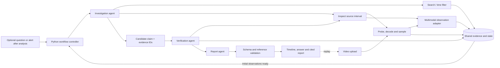
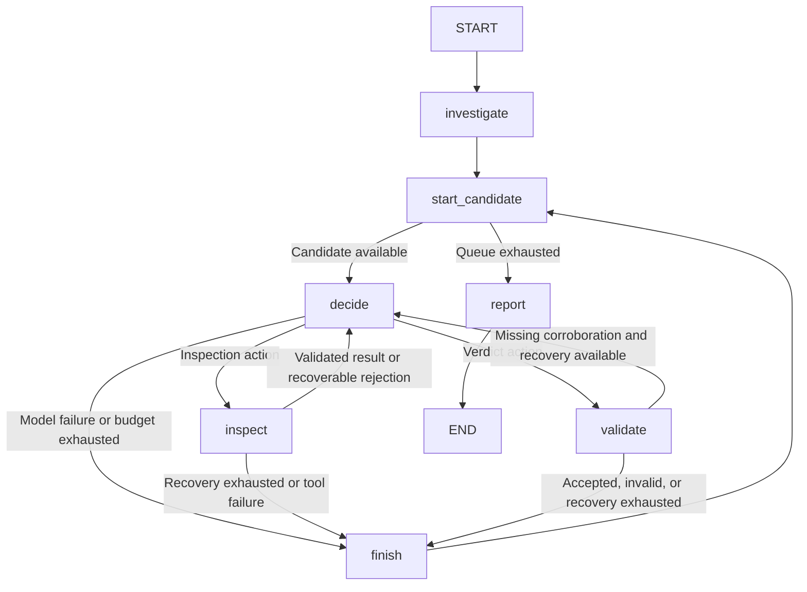

# System architecture

Status: video-first workflow finalized. The offline vertical slice and E1 pilot exercise the pipeline on project footage. Broader perception and agent performance remain unmeasured. [ADR-001](decisions/ADR-001.md) records the boundaries of the decision. The experiment in [implementation-plan.md](implementation-plan.md) precedes agent implementation.

## Objective and scope

Video ingestion automatically starts frame observation, investigation, verification, timeline reconstruction, and a chronological evidence-grounded report. Users can then ask natural-language questions and retrieve supporting video evidence. A user-supplied candidate alert enters the same investigation and verification workflow. Support a small, agreed taxonomy of visible events; do not infer identity, intent, ownership, unseen actions, or causation from temporal order. Real-time monitoring and biometric identification are out of scope.

Finalized project constraints are the four capabilities, integrated alert verification, meaningful multi-agent coordination, source traceability, and course-scale implementation. The following are **selected design choices**, not experimentally validated facts: a single Python process; three specialized agents controlled by a bounded deterministic state machine; FFmpeg/ffprobe; SQLite and lexical search; and a replaceable hosted multimodal model. Their feasibility, retrieval quality, costs and model behavior remain open.



## Proposed Python boundaries

The following paths are an intended layout, not a claim that code exists:

```text
src/security_augmented/
  contracts.py              # versioned records and invariant validation
  video.py                  # probe, sample, clip and replay mapping
  observation.py            # multimodal provider adapter
  evidence_store.py         # SQLite persistence and source resolution
  retrieval.py              # FTS, metadata filtering and candidate merging
  timeline.py               # deterministic ordering and conservative grouping
  agents.py                 # investigation, verification and reporting roles
  workflow.py               # state machine, budgets, logging and handoffs
  report.py                 # citation checks and rendering
tests/                      # contract, timestamp, integration and evaluation tests
```

Use typed Python records with explicit schema versions. Pydantic is a candidate for validation, not yet a verified dependency. Define and test the contracts before building agents. Do not add an agent framework or vector service unless an experiment demonstrates a need.

## Contracts and provenance

Times are source-relative integer microseconds; intervals are half-open `[start_us, end_us)`, with `0 <= start_us < end_us <= duration_us`. Keep original presentation timestamp (PTS), rational stream time base, and the first displayed frame's PTS. Source-relative time is `(frame_pts - first_display_pts) * time_base`; preserve the unrounded rational mapping as well as the displayed integer value. If usable frame PTS or a trustworthy duration cannot be established, fail explicitly or mark the source uninspectable; do not invent a timestamp. Record actual decoded frames or the actual clip range, not only requested seek times. No wall-clock date is asserted without separately validated metadata.

| Record | Required fields and invariant |
|---|---|
| `Video` | `id`, SHA-256 of source bytes, source path, stream index, duration, time base, first displayed PTS, probe version; path must resolve to a file with the recorded hash. |
| `Inspection` | `id`, `video_id`, requested interval, modality (`frames` or `clip`), actual source frame PTS/times or actual clip bounds, extraction settings, extraction version, status; each actual time resolves within the source. |
| `Observation` | `id`, `inspection_id`, category, literal description, evidence frame IDs or inspected clip bounds, visibility limits and uncertainty; never imply continuous observation from sparse frames. |
| `Claim` | `id`, atomic statement, proposed source interval, evidence IDs; candidate status is separate from truth. |
| `Verdict` | claim ID, `supported`, `contradicted`, or `insufficient`, supporting and contradicting evidence IDs, rationale and follow-up/stop reason. |
| `Investigation` | ID, question or alert, state, ordered handoffs, tool requests/results, limits, usage, failures and stop reason. |
| `Report` | ordered claim/verdict IDs, rendered statements, source citations, gaps and uncertainty. |

Version or append records: a later inspection can contradict an observation without overwriting it. A citation resolves claim → verdict → observation → inspection → original video hash and exact sampled PTS or clip interval. An observation is a fallible interpretation; an intact citation demonstrates provenance, not factual correctness. Check hashes, ID existence, interval bounds, and inspected-evidence membership deterministically; a model or human must assess semantic support.

## Interfaces and data flow

These are logical signatures, not implemented APIs. All tool results carry either a typed value or a structured error; errors and actual tool inputs are logged.

| Boundary | Proposed interface and responsibility |
|---|---|
| Ingestion | `ingest(path: Path) -> Video`; hash original bytes, probe selected video stream, establish source origin and duration. |
| Timestamped extraction | `sample(video: Video, interval: Interval, requested_times_us: list[int]) -> Inspection`; decode selected source frames, record actual PTS and source mapping. `extract_clip(video, interval) -> Inspection` records actual decoded bounds and source/clip mapping. |
| Observation | `observe(inspection: Inspection, taxonomy: Taxonomy) -> list[Observation]`; adapter sends only the selected visual input plus explicit timestamp labels, requests structured literal descriptions and citations, then validates references. A clip-relative model time is mapped back using recorded extraction mapping and is never treated as exact without validation. |
| Store | `put(record) -> id`, `get(id) -> record`, `resolve_evidence(id) -> SourceReference`; transactional SQLite writes retain versions, errors, models, prompts and configuration. Source files remain read-only. |
| Reconstruction | `build_timeline(observations) -> list[TimelineItem]`; sort by source time; conservatively group overlapping compatible observations, preserve conflicts and uncertain order. No inferred causality or invisible event. |
| Retrieval | `search(query, video_id, interval?, k) -> list[RetrievalHit]`; FTS plus metadata/time filters ranks windows linked to evidence IDs. A separate `inspect_time_range` path works without a text hit. |
| Reinspection | `inspect(video_id, interval, sampling_policy, reason) -> Inspection + observations`; controller checks budget, decodes original footage and records exact actual inputs. |
| Verification | `verify(claim, evidence_ids, tool_access, budget) -> Verdict | InspectionRequest`; role may request adjacent or denser footage or contrary candidates; controller executes requests, then returns to verification. |
| Reporting | `draft(verdicts, evidence) -> ReportDraft`; `validate_report(draft, store) -> ValidatedReport | errors`; require valid claim-level links, preserve contradiction and insufficiency, render citations with playable source references. |
| Coordination | `run_investigation(input, budget) -> InvestigationResult`; deterministic transitions validate all handoffs, count calls, record failures and stop on limits. |

Window observations are retrieval units, not necessarily event boundaries. Initial windows, e.g. 10 seconds with 2 seconds overlap and approximately one frame per second, are **experimental parameters**. Sparse sampling misses events between frames; a missing search result is not evidence of absence. Index lexical text and metadata first; compare text embeddings on independent paraphrase queries before making them a dependency. Exact in-process vector search is a candidate; a separate vector database is not selected.

## Agent handoffs

1. **Investigator** starts from the video observations, proposes ordered events and selects intervals to investigate. For follow-up questions or alerts it chooses search terms or explicit intervals; invokes retrieval and inspection tools; proposes atomic candidate claims and supporting/contrary evidence IDs. It cannot mark its own claim verified.
2. **Verifier** examines the candidate and source visual inputs, decides whether to request bounded additional inspection or contrary evidence, and returns a supported, contradicted, or insufficient verdict. Same-model reinspection is not independent proof; visibility gaps and conflicting observations persist.
3. **Reporter** selects verified claims and describes uncertainty. It cannot promote an insufficient or contradicted candidate to an established fact. Deterministic checks reject dangling or out-of-range citations; semantic support remains a separate assessment.

The controller enforces allowed tool calls and configurable maximum calls, candidates, reinspection requests, and retries. On budget exhaustion or tool failure it records the reason and returns an inconclusive result when evidence is inadequate. Deterministic decoding, timestamp math, sorting, filtering, validation and rendering are ordinary functions, not agents.

## Evidence limitations and technology references

FFprobe exposes frame information and timestamps, while FFmpeg seeking may start near a seek point; actual decoded PTS and replay checks are therefore required. [ffprobe](https://ffmpeg.org/ffprobe.html), [FFmpeg](https://ffmpeg.org/ffmpeg.html). Google documents video inputs and structured output, but availability, exact model identifier, handling of sensitive footage, performance, and the frame/clip comparison must be established for the project. [Video understanding](https://ai.google.dev/gemini-api/docs/video-understanding), [structured output](https://ai.google.dev/gemini-api/docs/structured-output). SQLite FTS and local text embeddings are documented options, not evidence of adequate recall. [SQLite FTS5](https://www.sqlite.org/fts5.html), [Sentence Transformers](https://www.sbert.net/examples/sentence_transformer/applications/semantic-search/README.html).


## Implemented vertical slice

`security_augmented.workflow` runs three deterministic role policies under a bounded controller. In the offline CLI, frame observations initialize investigation and the verifier retrieves matching clip evidence from the archive. The reporting role presents corroborated timeline events and unresolved findings. The trace records tool decisions and handoffs. Each citation resolves to original source timestamps, frame PTS and an evidence inspection ID. Agreement between modalities from the same model is corroboration within the inspected evidence and does not establish identity, intent, abandonment, or unattended duration.

The archive CLI persists a Markdown report and a shared JSON snapshot containing the observations, timeline, trace, and resolved citations. The standard library provides time and lexical follow-up retrieval. An explicit time query with no matching event may attach up to three source frames for review. The provider-injected entry point for new recordings samples bounded ten-second windows, validates provider output, and requests bounded short clip reinspection. Durable SQLite state and advanced retrieval remain open. No hosted call is necessary for this slice.

## Optional Gemini role decisions

The deterministic roles remain the default baseline. Pass a decision callable to `analyze_archive` or `analyze_video` to select the structured role workflow in `security_augmented.agents`. `GeminiDecider` uses the existing Google GenAI client and explicit authorization gate. The three role models and the video understanding model can be configured through `GEMINI_INVESTIGATION_MODEL`, `GEMINI_VERIFICATION_MODEL`, `GEMINI_REPORTING_MODEL`, and `GEMINI_VIDEO_MODEL`. All default to `gemini-3.5-flash-lite` for this workflow. The video role also recognizes the existing `GEMINI_MODEL` fallback. Archived experiment model selection remains tied to the archived requests.

- Investigation receives the initial source-linked observations and chooses whether to search a time interval and which observation IDs to delegate.
- Verification receives a delegated observation and applicable shared evidence. It may request frame or clip inspection before deciding. The archive runner retrieves matching verified observations, while the provider-injected runner can decode the authorized source interval and invoke the video understanding adapter. Successful results become available to later overlapping tasks. Support requires corroboration from a separate inspection that cites at least one new source frame. Overlapping placement and removal observations keep the finding unresolved when correspondence is unclear. An unsupported verdict means the candidate lacks adequate support; it does not prove the opposite.
- Reporting chooses a supported lead and whether to emphasize evidence or unresolved findings. Python renders all findings chronologically and resolves timestamps and citations from the controller's validated records. A failed, malformed or unsupported report decision falls back to deterministic rendering.

The controller checks action names and fields, available evidence IDs, source time bounds, inspection duration, duplicate requests and run budgets before executing any tool. No model action can execute code or shell commands. The defaults cap role calls at 24, searches at 3, clip or frame reinspections at 4, and initial video windows at 12. The authorized Gemini adapter disables SDK continuation for role and video requests in this path. The trace records concise justifications, handoffs, tool outcomes, evidence IDs and verdicts. It does not store private reasoning or API credentials. This mode starts with video observations without a user question. Follow-up queries retain the existing local behavior.

## Optional StateGraph orchestration

StateGraph owns the verification transitions and makes the recovery cycle visible. Investigation, its existing search loop, the Gemini SDK integration, action and citation validation, archive lookup and source inspection, hard budgets, authorization, and safe report rendering remain ordinary Python. The custom controller is still the default. The graph adds a dependency and some node wiring. A single recovery branch would take less code in the custom loop, while the graph makes the failure routing and per-candidate state explicit for comparison. No model wrapper, hosted tracing, checkpointer, or new evidence store is used. [LangGraph Graph API](https://docs.langchain.com/oss/python/langgraph/graph-api) · [StateGraph reference](https://reference.langchain.com/python/langgraph/graph/state/StateGraph)



| State | Contents |
|---|---|
| Investigation | Initial findings and remaining candidate queue |
| Current task | Candidate, visible evidence keyed by observation ID, pending decision and latest tool result |
| Recovery | Structured code, reason, candidate ID and remaining recovery allowance, plus per-candidate turns and recoveries used |
| Output | Completed event records, route and rendered report |

Run-local Python state retains the shared retrieved findings, trace, and global call, search, inspection and execution-failure counters. The graph does not receive credentials or provider internals in its state. Missing corroboration and pre-execution inspection rejections can return structured feedback to the verifier using the same per-candidate recovery allowance. Inspection feedback includes the rejected arguments and current tool constraints. Rejected requests do not consume an inspection slot or the run-wide failure budget. An invalid verdict or citation ends its candidate without spending the global failure allowance. Model and executed-tool failures retain the run-wide failure policy. A finding without sufficient evidence remains unresolved. The model selects whether and how to retrieve evidence. The controller enforces all bounds independently of the graph, which also has a superstep limit. LangSmith tracing is disabled inside graph execution to keep state and traces local.

The controlled graph comparison allows one recovery and up to three verification turns per candidate, enough for an initial verdict, inspection and revised verdict. The hard run-wide limit remains six model decisions with one slot reserved for reporting, one search, two inspections, and one terminal execution failure. The offline demonstration scripts the initial mistake and responds to feedback without encoding a dataset-specific action in the graph. It uses the same archived evidence for the baseline, custom controller and graph.

## Correspondence, coverage and completion contracts

Agent verdicts include pairwise correspondence assessments. Each pair identifies an available observation and classifies it as `same_event`, `different_events`, or `unresolved`, with exact excerpts from both archived descriptions. A same-event assessment must name a source frame cited by both views. To corroborate a positive event, the second observation must also match the category, come from a different inspection, and cite additional source frames. The validator verifies these anchors and retains only grounded support citations. Overlapping placement and removal observations require explicit disambiguation before support. The excerpts and common frame constrain model judgment. They do not provide object identity or semantic proof of correspondence. Uncertain pairs leave findings unresolved.

A successful archived inspection stores actual coverage in source-relative microseconds. A clip contributes its verified decoded source span. Frame evidence contributes sampled timestamp points, represented as one-microsecond intervals. Archive tools return requested bounds, actual coverage intersected with the request, citation spans, excluded overlapping citations, and historical failure counts. Status distinguishes `covered_with_findings`, `covered_without_findings`, `partial`, `missing`, and `failed`. The controller excludes straddling findings from that tool response without truncating their citations or descriptions. A successful empty result is scoped to inspected media.

Investigation delegates candidate IDs and supplies a disposition for each other visible initial observation. Dispositions are deferred, excluded with a reason, or associated with a delegated candidate. Association reuses the existing correspondence validator. It requires exact excerpts from both observations and a shared cited source frame. Unseen or silently omitted initial observations remain unaccounted for, even when the verification queue finishes. Older scripted responses without dispositions can still run with this accounting.

Verification receives associated observations with the delegated task. Association alone leaves the observation open. A supported verdict may resolve it explicitly by grounding the association against accepted corroborating evidence from a separate inspection with additional source frames. The resolution links both observation IDs and records the correspondence in the trace. Deferred, omitted, and unresolved associated observations retain their source citations in the report's unresolved findings, without creating additional verification tasks.

Completion records initial and accounted observation counts, per-observation dispositions, and completed versus delegated checks. Full completion requires complete triage, a finished verification queue, and no open triage observations. An accepted unresolved verdict completes its check while retaining uncertainty. A budget or execution failure leaves its check unfinished. The deterministic renderer reports coverage and queue progress independently and retains accepted findings after later failures. The baseline keeps its original reporting behavior.

Graph state owns the graph run's retrieved evidence and per-candidate state. The visible view is recalculated from the delegated finding and relevant shared evidence. The original Python controller maintains its own evidence store. Run-local counters and trace records remain owned by the shared agent runtime. Investigation receives a bounded evidence shortlist and the Gemini action schema offers search only if there are additional findings outside the prompt. Verification receives its usable decision budget excluding the reporting reservation and a flag indicating whether an inspection and reconsideration both fit.

### Gemini role transport

The authorized synchronous role client sets Google GenAI SDK HTTP attempts to one and disables redirects, function calling, and continuation. The role request boundary owns the sole retry policy. It can resend the same request once after HTTP 408, 500, 502, 503, or 504. It waits one second plus up to one second of random jitter before the resend. HTTP 429, other client errors, exceptions without an HTTP response, and invalid structured output are terminal for that logical request. Retry-After is retained as a diagnostic when safely available.

A pre-send hook enforces both the two-attempt limit and a separate run-wide physical request cap. The controlled archive evaluation allows six logical calls and at most twelve physical attempts. Each role call records ordered attempts with the run-wide request number, HTTP status when received, retry delay, and allowlisted error diagnostics. The controller consumes a single logical slot and processes at most one returned decision. An exhausted provider request follows the existing execution-failure policy. Accepted findings survive, unfinished checks remain incomplete, and reporting can render deterministically.

### New-video CLI

The workflow CLI can run the existing `analyze_video` path with Gemini and StateGraph once both media and observation-text transfer are authorized. A bounded prefix scan uses configurable window length and frame spacing. Verification uses the existing targeted frame or clip tools. Each attempt retains its requested interval, phase, available extracted-frame provenance and inference metadata. The coverage record distinguishes successful frame sample points, submitted clip spans, and their complement on the source clock. A failed or budget-truncated initial scan prevents the overall investigation from being marked complete. Post-analysis questions use local retrieval. [Run protocol](new-video-evaluation.md)

## Current video-first delivery

The user-facing live video command runs LangGraph with independent relational tasks available and 500 ms initial sampling. The custom Python controller and the movement-only LangGraph comparison remain available for their respective evaluation paths. The delivery guide describes the current wire settings, physical request ceilings, and saved-result question mode. [Delivery guide](../README.md)
